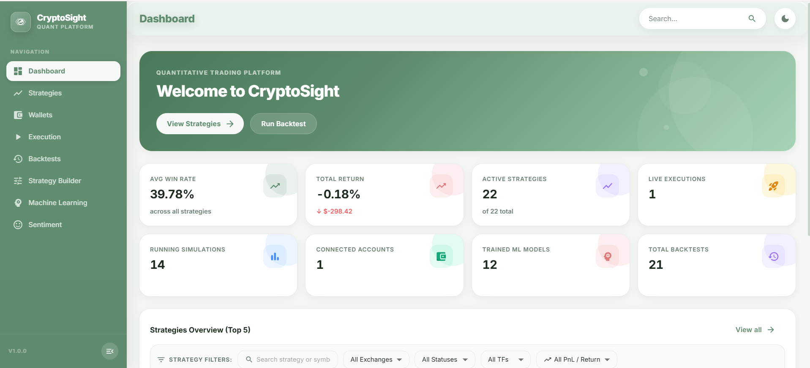
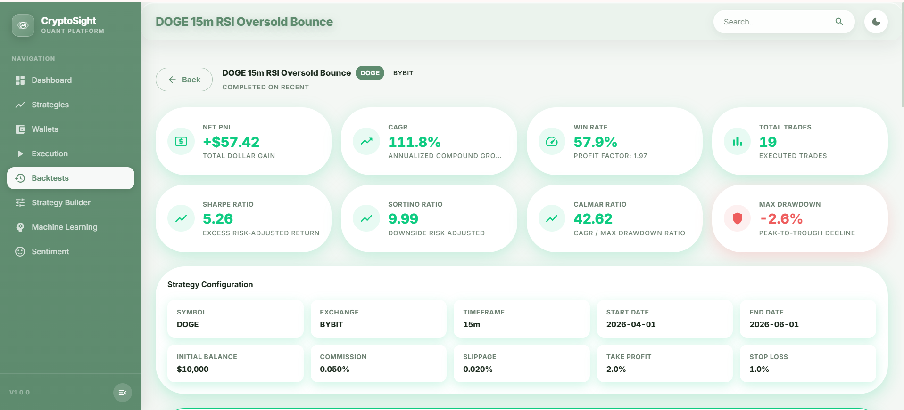
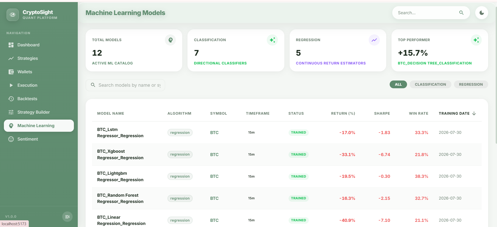
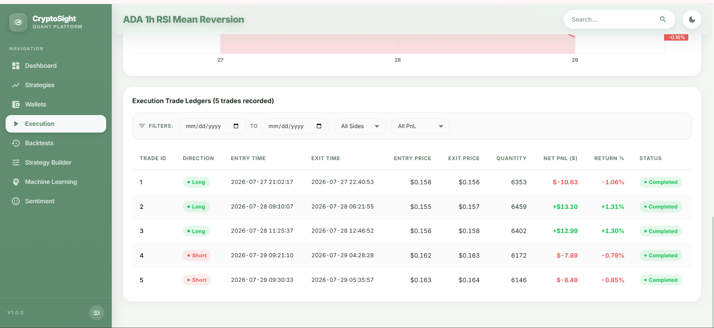
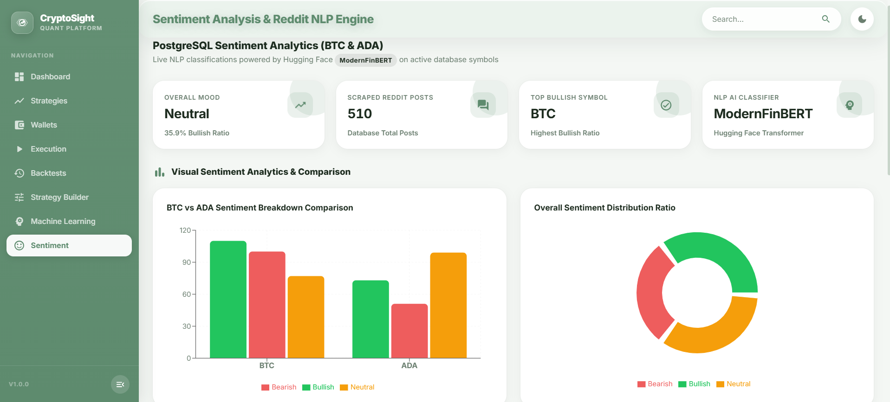
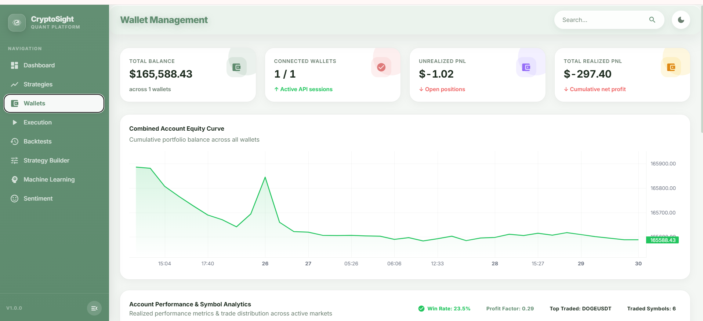
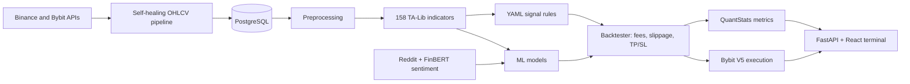

<div align="center">


<p>
  
  
  
  
  
  
</p>

AI/ML Engineering internship project at **NeuroG.AI** (Neuroship Fellowship)

</div>

---

## The problem

Building a crypto trading strategy that holds up is mostly plumbing: download years of candles without gaps, compute indicators without peeking into the future, train models on honest labels, backtest with real fees and slippage, and only then trust a bot with an exchange account. Each step is a place where a small mistake makes a strategy look profitable when it is not.

**CryptoSight** puts that whole chain in one quantitative trading platform, with a React terminal on top.

<table>
<tr>
<td align="center"><b>Dashboard</b><br/></td>
<td align="center"><b>Backtest analytics</b><br/></td>
</tr>
<tr>
<td align="center"><b>ML model inspector</b><br/></td>
<td align="center"><b>Live execution (Bybit testnet)</b><br/></td>
</tr>
<tr>
<td align="center"><b>FinBERT sentiment</b><br/></td>
<td align="center"><b>Exchange and wallet</b><br/></td>
</tr>
</table>

## The pipeline



| Module | What it does |
|---|---|
| **Data ingestion** (`data/`) | A gap-free OHLCV pipeline from Binance and Bybit into PostgreSQL that resumes on its own: it reads the newest stored timestamp and fetches only what is missing, with idempotent upserts, retries, UTC normalisation, gap filling, removal of unclosed candles, self-creating schemas and resampling (1m to 1d) |
| **Preprocessing** (`preprocessing/`) | Makes price series model-ready: fractional differencing for stationarity that keeps memory, winsorising of extreme values, robust scaling |
| **Indicators** (`tal_Indicators/`) | One wrapper over 158 TA-Lib indicators with Plotly rendering |
| **Signals** (`signals/`) | Declarative YAML rules for indicator crossovers, every feature shifted one bar to block look-ahead bias |
| **ML** (`ml/`) | Classification and regression models (XGBoost, LightGBM, Random Forest, SVM, logistic and linear regression, PyTorch LSTM), with saved configs and models per exchange, symbol and timeframe (for example Bybit BTC 15m) |
| **Sentiment** (`sentiment/`) | Reddit posts collected with PRAW and scored with Hugging Face FinBERT |
| **Backtesting** (`backtesting/`, `simulator/`) | Vectorised and bar-by-bar engines with 0.05% fees, 0.02% slippage, take-profit and stop-loss, trade ledgers and drawdown tracking |
| **Analytics** (`stats/`) | QuantStats ratios such as Sharpe, Sortino, Calmar, CAGR and maximum drawdown |
| **Execution** (`execution/`) | Automated order execution on the Bybit V5 API (testnet), with position reconciliation and account stats |
| **Terminal** (`backend/`, `frontend/`) | FastAPI services and a React dashboard with Lightweight Charts |

**Honest numbers by design:** a trade signalled at bar *T* fills at the open of bar *T+1*, and if live data is unavailable the API returns an explicit `*_unavailable` flag instead of made-up figures.

## My contributions

- Built the **self-healing market-data pipeline** that feeds the whole platform.
- Built the **preprocessing stage**: fractional differencing, winsorising and robust scaling.
- Trained and compared **XGBoost, LightGBM and LSTM** models on triple-barrier labels, judged by Sharpe ratio, Sortino ratio and CAGR, using backtests that charged fees and slippage and tracked drawdown.
- **Fixed defects in the live trading engine** and supported automated order execution on the Bybit testnet behind the React dashboard, served by FastAPI and PostgreSQL.

## Run it

```bash
git clone https://github.com/21Afnan/cryptosight.git
python -m venv venv && venv\Scripts\activate     # macOS/Linux: source venv/bin/activate
pip install -r cryptosight/requirements.txt
```

Set your PostgreSQL connection and Bybit testnet keys in the YAML configs under `data/` and `execution/`. Then, from the folder that contains `cryptosight/`:

```bash
python -m cryptosight.data.binance.main          # ingest market data
python -m cryptosight.data.bybit.main
python -m cryptosight.ml.main                    # train and evaluate models
python -m cryptosight.backtesting.backtest       # run a backtest
python -m uvicorn cryptosight.backend.main:app --reload --port 8000
```

Dashboard:

```bash
cd cryptosight/frontend
npm install
npm run dev                                      # http://localhost:5173
```

API docs are at `http://localhost:8000/docs`. Live execution (`python -m cryptosight.execution.main`) is meant for the **Bybit testnet**; this is research software, not financial advice.

## Repository layout

```
cryptosight/
├── data/            # Binance and Bybit ingestion, PostgreSQL gap filling
├── preprocessing/   # fractional differencing, winsorising, scaling
├── tal_Indicators/  # TA-Lib wrapper
├── signals/         # YAML rule engine
├── ml/              # feature builder, models, inference
├── sentiment/       # Reddit + FinBERT
├── simulator/       # bar-by-bar engine
├── backtesting/     # vectorised backtester
├── stats/           # QuantStats analytics
├── execution/       # Bybit V5 executor
├── backend/         # FastAPI routers and services
├── frontend/        # React trading terminal
└── docs/            # screenshots and presentation
```

---

<div align="center">

**Afnan Shoukat**

<a href="mailto:afnanshoukat35@gmail.com"></a>
<a href="https://www.linkedin.com/in/afnanshoukat"></a>
<a href="https://github.com/21Afnan"></a>

</div>

